<div align="center">

# A Mini-Project Report

### On

## “SealedBallot: A Tamper-Proof Commit–Reveal Voting System on the Ethereum Blockchain”

### Blockchain Technology

<br>

**Submitted by**

| Name | Roll No. |
|---|---|
| Vedant Rane | 29 |
| Greshal Saldanha | 31 |
| Yash Urade | 59 |
| Aryan Waghmare | 62 |

<br>

**Submitted to**

**Mrs. Madhuri Kumbhar**
Assistant Professor
Department of Computer Engineering

</div>

---

## Table of Contents

| Sr. No. | Chapter Name |
|---|---|
| | [Abstract](#abstract) |
| 1. | [Introduction](#1-introduction) |
| 1.1 | [Problem Definition](#11-problem-definition) |
| 1.2 | [Motivation](#12-motivation) |
| 1.3 | [Objectives](#13-objectives) |
| 2. | [Blockchain Network and Data](#2-blockchain-network-and-data) |
| 3. | [Methods and Algorithms](#3-methods-and-algorithms-used) |
| 4. | [Software and Hardware Requirements](#4-software-and-hardware-requirements) |
| 5. | [Experiments and Implementation](#5-experiments-and-implementation) |
| 5.1 | [System Architecture](#51-system-architecture) |
| 5.2 | [Smart Contract Development](#52-smart-contract-development) |
| 5.3 | [Full-Stack Web Application](#53-full-stack-web-application) |
| 5.4 | [User Interface Design](#54-user-interface-design) |
| 5.5 | [Testing and Results](#55-testing-and-results) |
| 5.6 | [Libraries Used](#56-libraries-used) |
| 6. | [Conclusion](#6-conclusion) |
| 7. | [References](#7-references) |

---

## ABSTRACT

This project designs and implements **SealedBallot**, a decentralised voting system built on the Ethereum
blockchain. Traditional online polls are controlled by a single server: the operator can change votes, see live
results, or delete ballots without anyone noticing. Simple blockchain voting fixes tampering but creates a new
problem: every vote is public the moment it is cast, so early votes can influence later voters.

SealedBallot solves both problems using a **commit–reveal scheme**. While voting is open, each voter submits only a
cryptographic commitment, `keccak256(electionId ‖ candidateId ‖ salt ‖ voterAddress)`, so no one, including the
organiser, can see the trend. After voting closes, voters reveal their choice and secret salt. The smart contract
recomputes the hash and counts the vote only if it matches. Every rule, vote and result is stored on-chain and can be
audited by anyone.

The system consists of a Solidity smart contract (developed and tested with Hardhat) and a full-stack **Next.js**
application. Its server-side API routes read blockchain state with **viem**, and the browser signs transactions
through **wagmi** and a crypto wallet. The contract passed 14 automated unit tests, and the complete election
lifecycle was verified with an automated end-to-end browser test.

**Keywords:** Blockchain, Ethereum, Smart Contract, Solidity, E-Voting, Commit–Reveal, Keccak-256, Next.js, Web3,
Decentralised Application (DApp)

---

## 1. INTRODUCTION

Elections are the basis of decision-making in governments, universities, clubs and companies. A fair election
needs three properties at the same time. It must be **tamper-proof**, meaning no one can change or delete a vote. It
must be **verifiable**, meaning anyone can check the result. And it must be **free from influence**, meaning no one
can see partial results while voting is still open.

Paper ballots achieve this using physical ballot boxes, seals and observers, but they are slow and expensive. Online
voting systems such as Google Forms are convenient, but they depend completely on trusting whoever controls the
server and database.

**Blockchain technology** offers a third option. A blockchain is a distributed ledger replicated across many
computers. Data written to it cannot be changed afterwards, and programs called **smart contracts** run exactly as
written, with no one able to interfere. **Ethereum** is the most widely used smart-contract platform. This project
uses Ethereum to build a voting system in which the ballot box itself is a smart contract.

### 1.1 Problem Definition

To design and develop a decentralised, tamper-proof voting system on the Ethereum blockchain that keeps every
individual vote **secret while voting is open**, counts votes **only after voting closes**, and allows **anyone to
independently verify** that their vote was recorded and counted correctly.

### 1.2 Motivation

College elections such as class representative, student council and fest committees are usually run using
show-of-hands, paper slips or online forms. Each of these has problems: results can be manipulated, voters are
influenced by visible partial results, and nobody outside the organising team can verify the final count.

A naive blockchain solution, where each vote is a public transaction, removes manipulation but exposes the running
tally to everyone. That allows bandwagon voting and last-minute strategic voting. The motivation behind this project
is to show how a **cryptographic technique (commit–reveal)** combined with a **smart contract** can deliver the
security of a sealed physical ballot box with the transparency and convenience of a web application.

The project also provides practical exposure to the complete Web3 development stack: smart-contract programming,
automated contract testing, wallet integration, reading blockchain events, and building a production-grade full-stack
web application. This bridges the gap between the theory of blockchain and its real-world implementation.

### 1.3 Objectives

The primary objective of this project is to build a working decentralised application (DApp) for conducting secure
elections on Ethereum and to study how blockchain properties such as immutability, transparency and trustless
execution can be applied to voting.

The specific objectives of the project are as follows:

1. **To design a smart contract** that manages multiple independent elections, each with its own organiser,
   candidates, voter roll and lifecycle, and stores all data permanently on the Ethereum blockchain.
2. **To implement a commit–reveal voting protocol** so that votes remain hidden during the voting phase and are
   counted only after they are revealed and cryptographically verified.
3. **To enforce election rules on-chain**, including organiser-only administration, voter eligibility, one vote
   per voter, strict phase ordering (Setup → Commit → Reveal → Ended) and protection against copied or replayed votes.
4. **To develop a full-stack web application** using Next.js, where server-side API routes read and index blockchain
   data and the browser interacts with the contract through a crypto wallet.
5. **To provide verifiability to voters** through downloadable ballot receipts and a receipt-verification page that
   proves a vote was recorded and counted exactly as cast.
6. **To test and evaluate the system** using automated unit tests, gas-cost measurement, and an end-to-end browser
   test covering the complete election lifecycle.

---

## 2. BLOCKCHAIN NETWORK AND DATA

Unlike a machine-learning project, this project does not train on an external dataset. The **blockchain itself is
the database**: every election, vote and result is a record in the Ethereum state, written by transactions and
announced through event logs.

**Network used.** Development and testing were done on the **Hardhat Network**, a local Ethereum blockchain
(chain ID `31337`) that runs the same Ethereum Virtual Machine (EVM) as the main network. It produces a block
instantly for every transaction and provides 20 pre-funded test accounts. The same contract can be deployed without
any change to the public **Sepolia test network** (chain ID `11155111`). A deployment script is included for this.

**On-chain data model.** The table below shows what the `SealedBallot` contract stores.

| Data | Stored as | Description |
|---|---|---|
| Election | `struct Election` in an array | Title, description, organiser address, open-to-all flag, current phase, timestamps, counters (voters, commits, reveals) and the candidate list |
| Candidate | `struct Candidate { name, votes }` | Name and vote count; counts stay zero until the reveal phase |
| Voter roll | `mapping(electionId ⇒ address ⇒ bool)` | Which wallets may vote in a restricted election |
| Commitment | `mapping(electionId ⇒ address ⇒ bytes32)` | The sealed vote (32-byte hash) submitted by each voter |
| Revealed flag | `mapping(electionId ⇒ address ⇒ bool)` | Prevents a ballot from being counted twice |

**Event logs.** The contract emits five events: `ElectionCreated`, `VoterRegistered`, `PhaseChanged`,
`VoteCommitted` and `VoteRevealed`. Events are cheap, permanent and searchable. The web application's server reads
them to build the public **activity feed** (audit trail) for each election.

**Off-chain data.** The only data kept outside the blockchain is the voter's **ballot receipt**, a small JSON file
containing the secret salt. It is kept on the voter's own device and in a downloaded file, never on a server. A
sample receipt produced during testing is shown below:

```json
{
  "version": 1,
  "chainId": 31337,
  "contract": "0x5FbDB2315678afecb367f032d93F642f64180aa3",
  "electionId": 3,
  "electionTitle": "Best Final Year Project 2026",
  "candidateId": 0,
  "candidateName": "SealedBallot (Blockchain)",
  "voter": "0x70997970C51812dc3A010C7d01b50e0d17dc79C8",
  "salt": "0x4cc11f98fa640fe783cd7dad6c450d59fd362435aa7a2202f54a9c73ea1a8828",
  "commitment": "0xa0d61c84b1764968a3535042a64a44c9f9d9228b61d0213149c8380f2f2318cf"
}
```

**Demo data.** A seed script populates the local chain with three realistic college elections, one in each state:
*Tech Fest Theme 2026* (finished, with results), *Class Representative — TE Computer* (sealed voting in progress),
and *Canteen Menu Upgrade* (open-to-all poll still in setup).

---

## 3. METHODS AND ALGORITHMS USED

### 3.1 Commit–Reveal Scheme

The core technique is a **cryptographic commitment scheme**. A commitment works like a sealed envelope: you can
prove later what was inside, but nobody can look inside before you open it, and you cannot swap the contents after
sealing it.

**Commit phase.** The voter's browser generates a random 32-byte **salt** using the Web Crypto API and computes:

```
commitment = keccak256( electionId ‖ candidateId ‖ salt ‖ voterAddress )
```

Only `commitment` is sent to the blockchain. Because Keccak-256 is a one-way hash function and the salt is random,
nobody can work out the candidate from the commitment, even by trying every candidate. This is the **hiding**
property.

**Reveal phase.** The voter sends `candidateId` and `salt`. The contract recomputes the hash with the caller's
address and compares it with the stored commitment. The vote is counted only if they match. Since finding a
different (candidate, salt) pair with the same hash is computationally infeasible, the voter cannot change their vote
after committing. This is the **binding** property.

Including `electionId` and `voterAddress` inside the hash is a deliberate security measure. It prevents a malicious
user from copying someone else's commitment and then revealing it as their own, and it prevents replaying a
commitment in a different election.

### 3.2 Election State Machine

Every election moves through four phases in a strict order. Only the organiser can advance the phase, and each
function checks the current phase before doing anything (`inPhase` modifier).

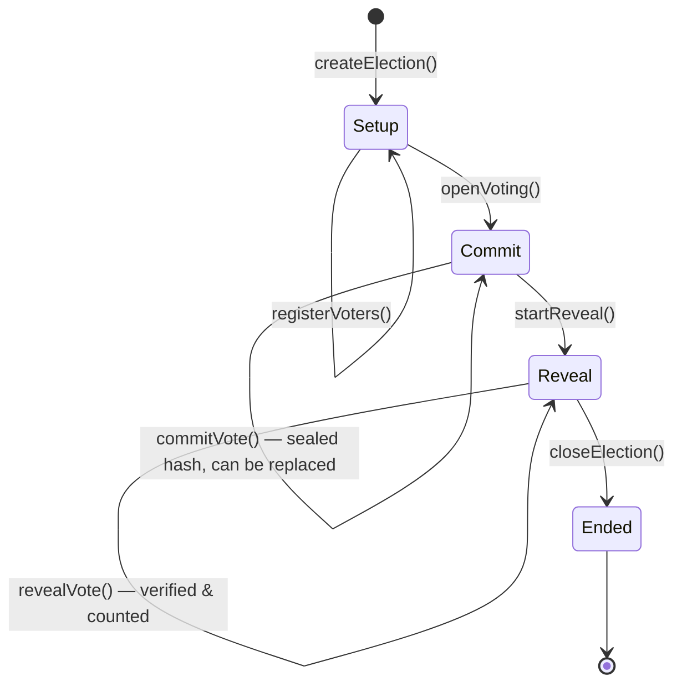

### 3.3 Algorithms

**Algorithm 1 — Commit a vote** (`commitVote(id, commitment)`)

```
1. require election id exists
2. require phase == Commit
3. require commitment != 0
4. require election.openToAll OR voter is registered        → else revert NotEligible
5. if voter had no previous commitment: commitCount += 1
6. store commitments[id][voter] = commitment                 (re-voting replaces the old one)
7. emit VoteCommitted(id, voter, commitment)
```

**Algorithm 2 — Reveal a vote** (`revealVote(id, candidateId, salt)`)

```
1. require phase == Reveal
2. stored ← commitments[id][voter];  require stored != 0     → else revert NothingCommitted
3. require not revealed[id][voter]                           → else revert AlreadyRevealed
4. require candidateId < number of candidates
5. require keccak256(id ‖ candidateId ‖ salt ‖ voter) == stored  → else revert CommitmentMismatch
6. revealed[id][voter] = true;  revealCount += 1;  candidates[candidateId].votes += 1
7. emit VoteRevealed(id, voter, candidateId)
```

**Algorithm 3 — Determine winners** (`getWinners(id)`, a free read-only call)

```
1. best ← max(votes of all candidates)
2. if best == 0 return []                                    (no votes counted)
3. return every candidate whose votes == best                (handles ties fairly)
```

### 3.4 Security Properties Achieved

| Threat | How SealedBallot prevents it |
|---|---|
| Changing or deleting votes | Votes live in contract storage; no function exists to edit or delete them |
| Organiser rigging the count | Counting is done by contract code that anyone can read; the organiser only advances phases |
| Seeing partial results | Only hashes exist during voting; tallies are zero until reveal |
| Double voting | One commitment slot per address; `revealed` flag blocks double counting |
| Ineligible voters | Voter roll enforced on-chain (`NotEligible`) |
| Copying another voter's sealed vote | Voter address is part of the hash, so the copy fails with `CommitmentMismatch` |
| Changing vote after seeing others | Binding property of the commitment; reveal must match the original hash |
| Unauthorised administration | `onlyOrganiser` modifier on every admin function (`NotOrganiser`) |

### 3.5 Gas Optimisation

Every write on Ethereum costs gas, so the contract was designed to be economical. It uses **custom errors** instead
of revert strings, packs counters into `uint32` and timestamps into `uint64` so they share storage slots, and enables
the Solidity optimizer (200 runs). Read-only functions such as `getWinners`, `getElections` and `computeCommitment`
cost nothing to call.

---

## 4. SOFTWARE AND HARDWARE REQUIREMENTS

### 4.1 Software Requirements

- Node.js 20 or later, with npm
- Solidity 0.8.24 compiler
- Hardhat 2 (Ethereum development environment and local blockchain)
- Next.js 16 with React 19 and TypeScript
- wagmi 3, viem 2 and TanStack Query 5 (Ethereum client libraries)
- Tailwind CSS 4
- A web browser (Chrome, Firefox, Brave or Edge), optionally with the MetaMask wallet extension
- VS Code / Cursor IDE
- Git

### 4.2 Hardware Requirements

- Intel/AMD processor (dual-core or better)
- Minimum 4 GB RAM (8 GB recommended)
- About 1.5 GB of free disk space for dependencies
- Windows / Linux / macOS operating system
- Internet connection (only required for installing packages or using the Sepolia test network)

---

## 5. EXPERIMENTS AND IMPLEMENTATION

### 5.1 System Architecture

The project is organised as two packages. `contracts/` holds the blockchain layer and `web/` holds the full-stack
application.

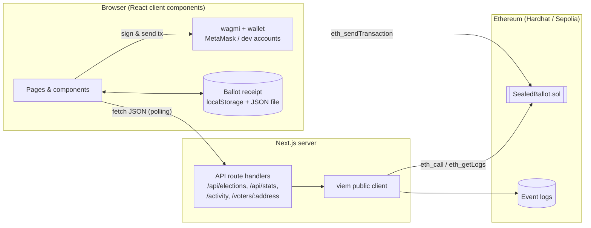

**Reads** flow through the Next.js server. API routes query the contract and its event logs, then return clean JSON
that the browser polls every 4 seconds. **Writes** never go through the server. They are signed in the voter's
wallet and sent directly to the blockchain, so the server can never forge or block a vote.

The sequence below shows one voter's complete journey:

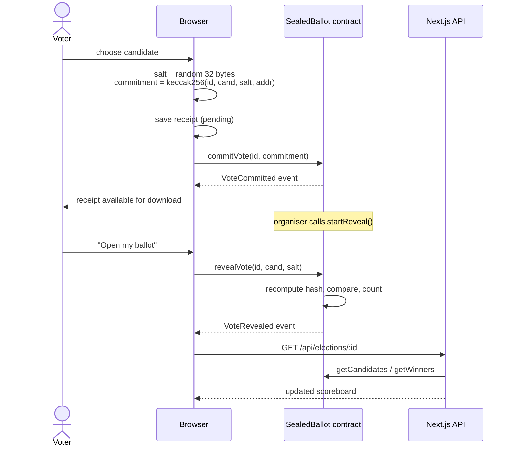

### 5.2 Smart Contract Development

The contract `SealedBallot.sol` (289 lines) was written in Solidity 0.8.24. Its public interface is:

| Function | Who | Phase | Purpose |
|---|---|---|---|
| `createElection(title, description, candidates[], openToAll)` | anyone | — | Creates an election (2–16 candidates); caller becomes organiser |
| `registerVoters(id, addresses[])` | organiser | Setup | Adds up to 100 voters per call; duplicates are skipped |
| `openVoting(id)` | organiser | Setup → Commit | Locks the roll and starts sealed voting |
| `commitVote(id, commitment)` | eligible voter | Commit | Submits or replaces a sealed vote |
| `startReveal(id)` | organiser | Commit → Reveal | Closes voting |
| `revealVote(id, candidateId, salt)` | voter | Reveal | Opens a ballot; counted if hash matches |
| `closeElection(id)` | organiser | Reveal → Ended | Freezes the result |
| `getElection`, `getElections`, `getCandidates`, `getVoterStatus`, `getWinners`, `computeCommitment` | anyone | any | Free read-only views |

The deployment script compiles the contract, deploys it, and **automatically exports the ABI and contract address**
into the web application (`web/src/contracts/`). This means the frontend always matches the deployed contract.

### 5.3 Full-Stack Web Application

The application uses the **Next.js App Router** and is full-stack. One codebase contains both the backend API and
the React frontend.

**Backend (API route handlers).** Server-side code uses a viem public client to read the blockchain:

| Endpoint | Returns |
|---|---|
| `GET /api/stats` | Chain ID, latest block, total elections, live elections, sealed and opened vote counts |
| `GET /api/elections` | Summary of every election (newest first) |
| `GET /api/elections/:id` | Full election with candidates, tallies and winners |
| `GET /api/elections/:id/activity` | Audit trail built from the five contract events, with block timestamps |
| `GET /api/elections/:id/voters/:address` | Eligibility, committed/revealed status and on-chain commitment of a wallet |

Errors are mapped to clear responses: `404` for unknown elections, `503` if the contract is not deployed, and `502`
if the Ethereum node is offline.

**Frontend pages.**

| Page | Features |
|---|---|
| `/` Home | Live chain statistics, filterable election board (All / Live / Setup / Final), protocol explainer |
| `/elections/new` | Create election: title, description, dynamic candidate list, voter roll or open-to-all, live validation and preview, two-step transaction progress |
| `/elections/:id` | Phase tracker, scoreboard (hidden as "??" until reveal), ballot panel (seal / change / open vote), organiser controls, on-chain activity feed |
| `/verify` | Upload or paste a receipt to check it in four steps |

**Wallet integration.** wagmi connects to any browser wallet (MetaMask, Rabby, Brave). For demonstrations on the
local chain, the app also offers **one-click demo accounts** (Hardhat accounts #0–#9). This makes it possible to
switch between organiser and voters instantly without configuring a wallet. Contract errors are decoded into
friendly messages, for example *"The receipt doesn't match the sealed vote on-chain (wrong candidate or salt)."*

**Receipt safety.** The receipt is first saved as *pending* before the commit transaction is sent, then confirmed
once the transaction is mined. If the browser is closed mid-transaction, or a vote change fails, the correct salt is
still recovered by matching it against the on-chain commitment. Voters can also import a receipt file on another
device before revealing.

### 5.4 User Interface Design

The interface was designed using real-world design references from **Refero** (a library of UI references from
real products), accessed through its MCP integration. The research process was:

1. **Style research.** Several visual directions were searched: *dark technical web3 protocol websites* (Solana,
   Sandclock, Cosmos, Axelar, Hyperliquid) and *editorial civic/trustworthy institutions* (CQCM, Open Collective).
2. **Screen research.** Voting and result screens were studied: Typeform and Maze survey-result bars, Kinhive's
   feature-voting board, the Stocktwits poll modal, and Mural/Miro voting sessions.
3. **Reference lock.** Instead of averaging styles, one primary direction was chosen and only two details were
   borrowed:

| Source | What was used |
|---|---|
| **Uniswap Cup** (primary) | Tournament *scoreboard* language: `#f2f2f2` canvas, pure black ink, white cards, 0 px sharp corners, monospace numerals for all data, and a single **fuchsia `#f50db4` accent** reserved for active states, leaders and winners |
| **CQCM** (borrowed) | Solid black pill button for the primary action |
| **Sandclock** (borrowed) | Outlined pill "Connect wallet" button in the header |

The election-as-a-tournament metaphor fits naturally. The four phases are drawn as a **bracket-style tracker**
(completed = black, current = fuchsia, upcoming = white). Candidates appear as **score blocks**, the leading or
winning candidate is highlighted in fuchsia, and sealed tallies show a hatched bar with `??`. Shadows, gradients
and extra colours were deliberately avoided, following the reference's rules.

### 5.5 Testing and Results

#### 5.5.1 Smart Contract Unit Tests

Fourteen automated tests were written with Mocha/Chai using Hardhat fixtures. **All 14 tests pass.**

```
  SealedBallot
    ✔ matches the on-chain commitment helper
    creation
      ✔ stores the election and candidates
      ✔ rejects fewer than two candidates
      ✔ ignores duplicate voter registrations
      ✔ only lets the organiser manage the election
    commit phase
      ✔ accepts sealed votes from registered voters only
      ✔ lets a voter change their sealed vote without double counting
      ✔ hides tallies while voting is open
      ✔ rejects commits outside the commit phase
    reveal phase
      ✔ counts valid reveals and declares the winner
      ✔ rejects a reveal that does not match the commitment
      ✔ prevents revealing twice
      ✔ stops a copied commitment from being revealed by someone else
      ✔ reports ties as multiple winners

  14 passing (2s)
```

#### 5.5.2 Gas Cost Analysis

Gas usage was measured with `hardhat-gas-reporter` during the test run:

| Operation | Min gas | Max gas | Avg gas |
|---|---|---|---|
| Deploy `SealedBallot` | — | — | 1,884,694 (3.1 % of block limit) |
| `createElection` | 176,682 | 285,435 | 263,684 |
| `registerVoters` | 31,252 | 108,117 | 92,744 |
| `openVoting` | 36,593 | 36,605 | 36,596 |
| `commitVote` | 36,600 | 59,240 | 57,151 |
| `startReveal` | 36,537 | 36,549 | 36,541 |
| `revealVote` | 66,269 | 83,369 | 80,519 |
| `closeElection` | — | — | 36,550 |

Each voter pays roughly **57k gas to commit and 80k gas to reveal**, about 137k gas in total. Creating an election
costs more because candidate names are stored on-chain. On a Layer-2 network such as Arbitrum, Optimism or Base,
these amounts cost a fraction of a rupee per vote.

#### 5.5.3 End-to-End Testing

An automated browser test (Playwright, headless Chromium) carried out a complete election through the real user
interface, connected to the local blockchain:

1. Organiser (account #0) created *Best Final Year Project 2026* with 3 candidates and 3 registered voters.
2. Organiser opened sealed voting.
3. Voters #1 and #2 sealed votes for *SealedBallot (Blockchain)*, and voter #3 for *Stock Price Predictor (ML)*.
   Voter #1's receipt was downloaded.
4. Unregistered account #5 was correctly shown *"This wallet isn't on the voter roll"*.
5. Organiser started the reveal phase, and all three voters opened their ballots.
6. Organiser finalised the result: **SealedBallot (Blockchain) 2 votes (67 %), Stock Price Predictor 1 vote
   (33 %)**, with 100 % turnout.
7. Voter #1's receipt was uploaded to the verify page, and **all 4 checks passed**.

All API endpoints were also tested directly, including the error cases (`404` for a missing election).

#### 5.5.4 Output Screenshots

**Fig 5.1 — Home page: live chain statistics and election board**


**Fig 5.2 — Creating an election (candidates and voter roll)**

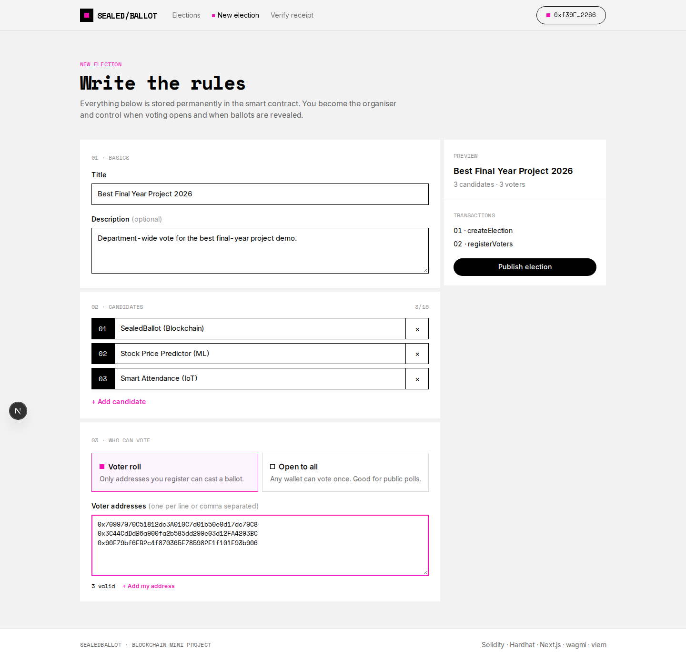

**Fig 5.3 — Setup phase with organiser controls**

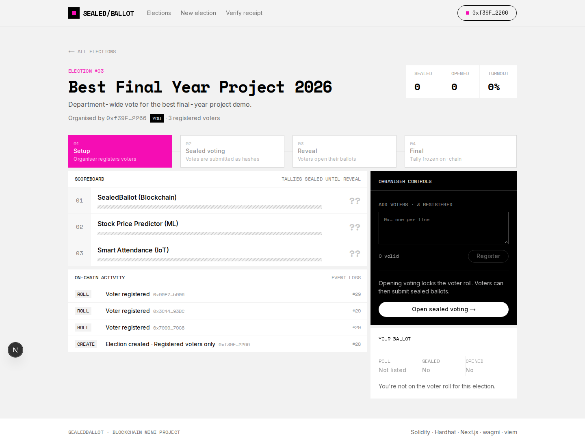

**Fig 5.4 — Sealed voting: tallies hidden ("??"), vote stored only as a hash, receipt saved**

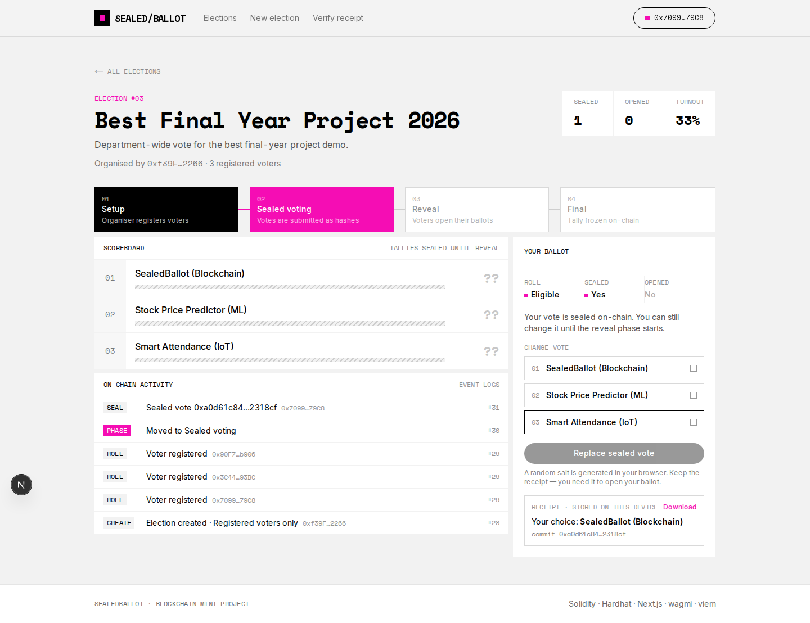

**Fig 5.5 — Ineligible wallet blocked from voting**

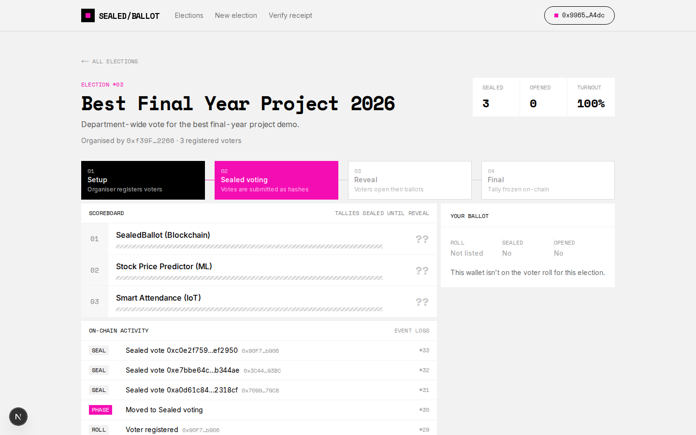

**Fig 5.6 — Reveal phase: ballots being opened and counted live**

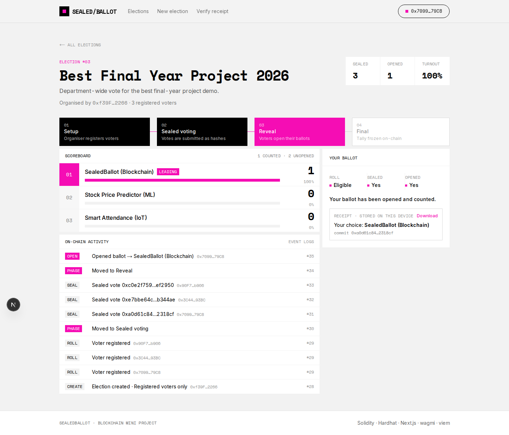

**Fig 5.7 — Final results with winner and full on-chain audit trail**

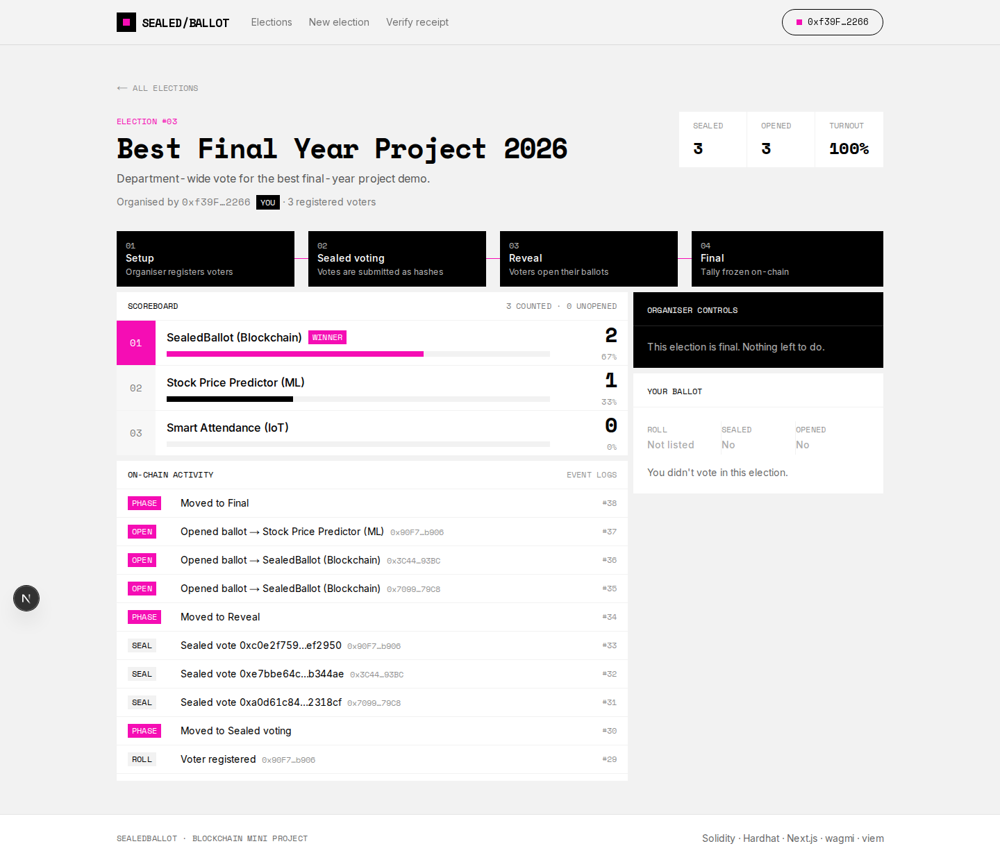

**Fig 5.8 — Receipt verification: all four checks passed**

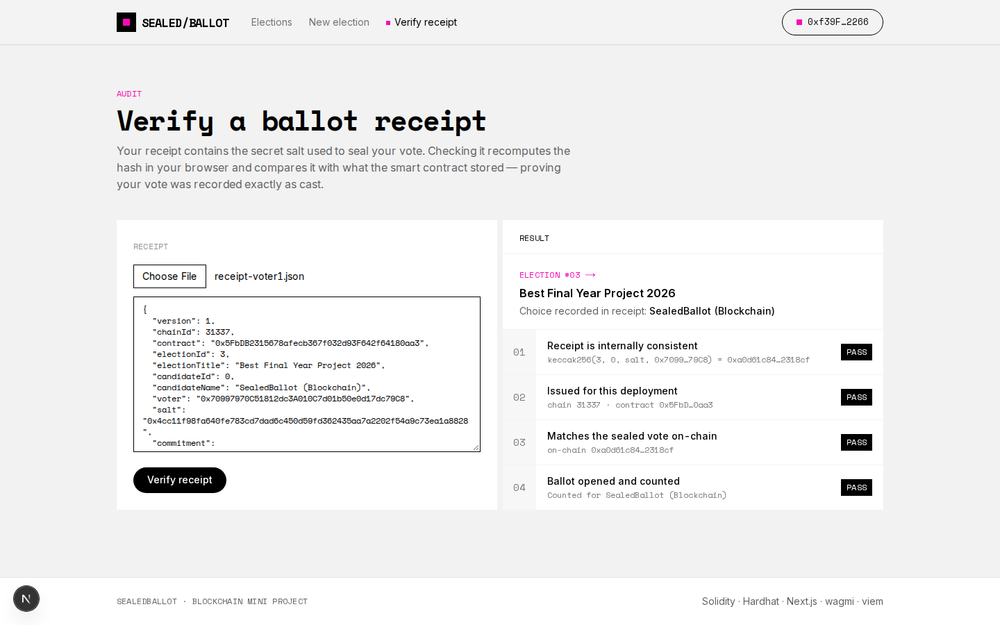

**Fig 5.9 — Seeded demo election "Tech Fest Theme 2026" (finished)**

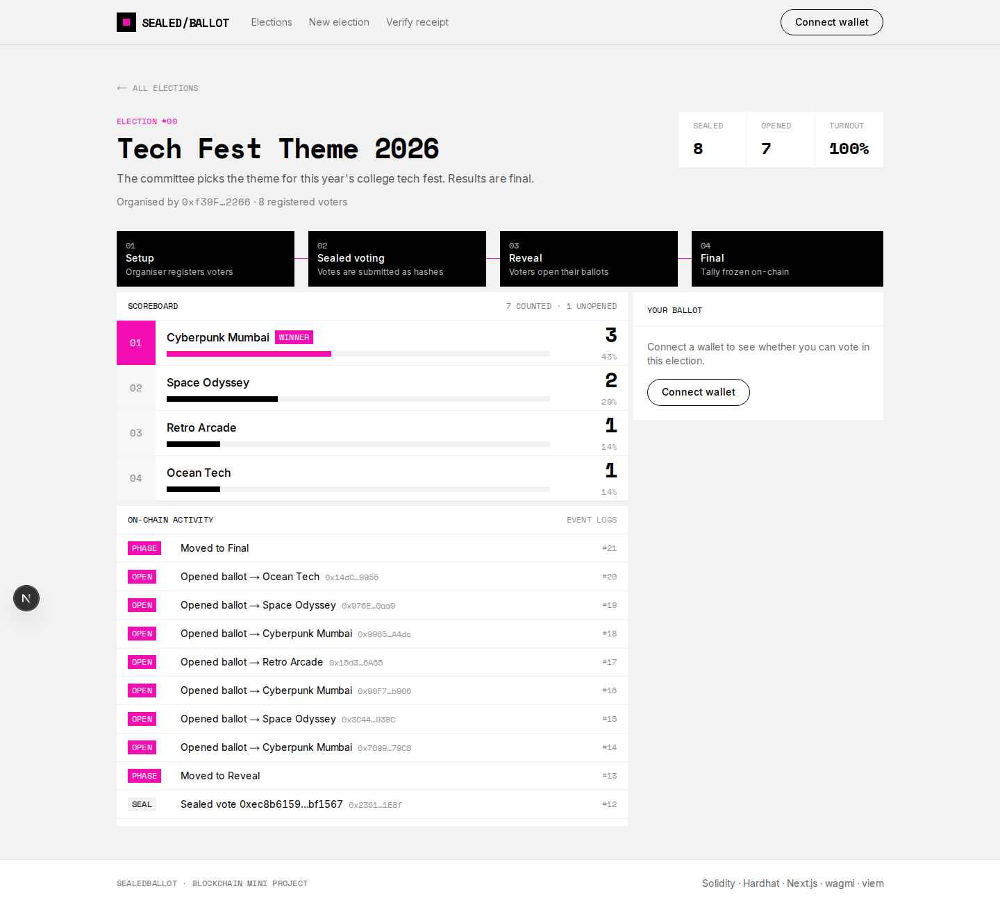

### 5.6 Libraries Used

- **Solidity** – The programming language for Ethereum smart contracts. It was used to write `SealedBallot.sol`,
  which contains all the election rules, the commit–reveal verification and the vote counting.
- **Hardhat** – An Ethereum development environment. It was used to compile the contract, run a local blockchain
  node, run the automated tests, measure gas usage and deploy the contract.
- **Ethers.js / Hardhat Toolbox** – Used inside the tests and scripts to deploy contracts, send transactions from
  multiple test accounts and compute commitments.
- **Mocha & Chai** – Testing framework and assertion library, used to write the 14 unit tests, including checks for
  custom-error reverts and emitted events.
- **Next.js** – A React framework for full-stack applications. It was used for page routing, server-side API route
  handlers that read the blockchain, and the production build.
- **React** – A UI library used to build interactive components such as the ballot panel, scoreboard, phase tracker
  and activity feed.
- **viem** – A lightweight, type-safe Ethereum library. It was used on the server to read contract state and event
  logs, and in the browser to compute Keccak-256 commitments and decode contract errors.
- **wagmi** – React hooks for Ethereum. It was used for wallet connection, network switching and sending
  transactions to the contract.
- **TanStack Query** – Data-fetching and caching library, used to poll the API routes and refresh the UI after each
  transaction.
- **Tailwind CSS** – A utility-first CSS framework, used to implement the Refero-derived design tokens.
- **Playwright** – Browser automation library, used for the end-to-end test and for capturing the screenshots in
  this report.

---

## 6. CONCLUSION

The project successfully designed, implemented and tested **SealedBallot**, a decentralised voting system on the
Ethereum blockchain. The commit–reveal scheme keeps each vote secret while voting is open and makes it impossible to
change after submission. The smart contract enforces eligibility, one vote per person, organiser-only
administration and strict phase ordering, without any trusted server. Every election and every ballot leaves a
permanent public record, and voters can independently verify, using their receipt, that their own vote was counted
exactly as cast.

The project shows that blockchain can provide the three properties a fair election needs: tamper-proof storage,
public verifiability, and freedom from influence during voting. It also shows that a modern full-stack framework
like Next.js can make a decentralised application as easy to use as an ordinary website.

**Limitations.**
- After the reveal phase, each voter's choice becomes publicly linked to their wallet address. Secrecy is temporary,
  lasting only during voting, not permanent.
- A voter who loses their receipt (salt) cannot reveal, so their vote is not counted.
- Every action needs a transaction, so voters need a small amount of ETH for gas on a public network.
- Phases are advanced manually by the organiser rather than by deadlines.

**Future scope.**
- Use **zero-knowledge proofs** (for example Semaphore or MACI) so that votes stay anonymous permanently while
  remaining verifiable.
- Add time-based deadlines so phases advance automatically.
- Use **gasless (meta) transactions** so voters don't need ETH, and deploy on a low-cost Layer-2 network.
- Add identity verification, such as college email or DigiLocker attestation, for building voter rolls.
- Support ranked-choice and weighted voting.

---

## 7. REFERENCES

1. Ethereum Foundation, *Ethereum Whitepaper and Developer Documentation*: https://ethereum.org/en/developers/docs/
2. Solidity Documentation (v0.8.24): https://docs.soliditylang.org
3. Hardhat Documentation: https://hardhat.org/docs
4. Next.js Documentation: https://nextjs.org/docs
5. wagmi Documentation: https://wagmi.sh
6. viem Documentation: https://viem.sh
7. G. Wood, *Ethereum: A Secure Decentralised Generalised Transaction Ledger* (Yellow Paper): https://ethereum.github.io/yellowpaper/paper.pdf
8. Commitment scheme (hiding and binding properties): https://en.wikipedia.org/wiki/Commitment_scheme
9. Refero — UI and design references (Uniswap Cup, CQCM, Sandclock style references): https://refero.design
10. Sepolia Testnet information: https://ethereum.org/en/developers/docs/networks/#sepolia
11. Tailwind CSS Documentation: https://tailwindcss.com/docs
12. Playwright Documentation: https://playwright.dev
